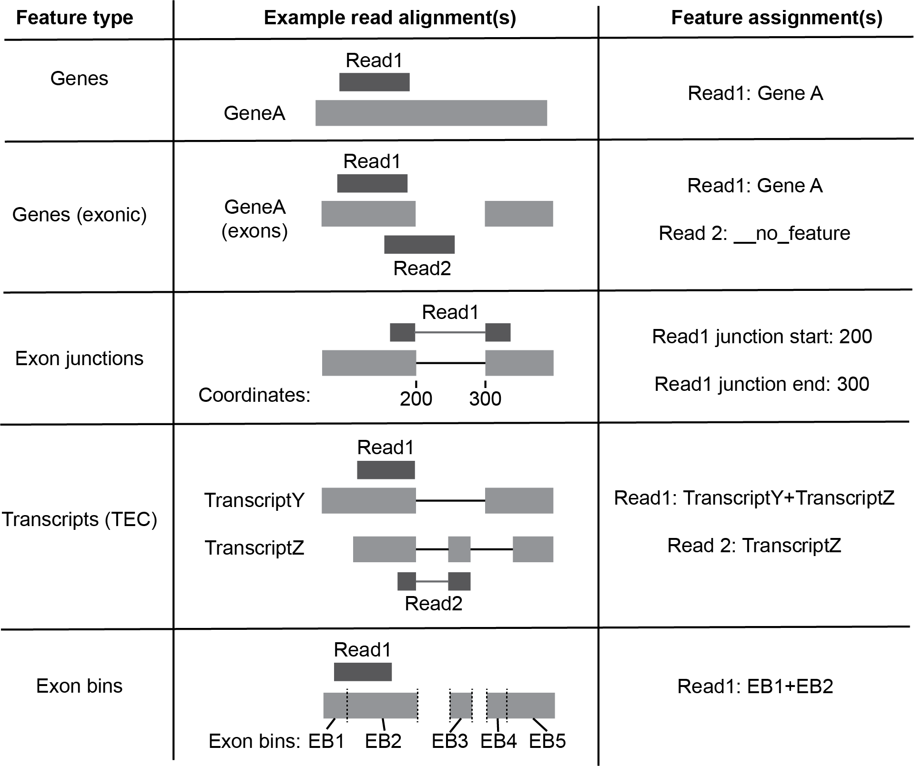
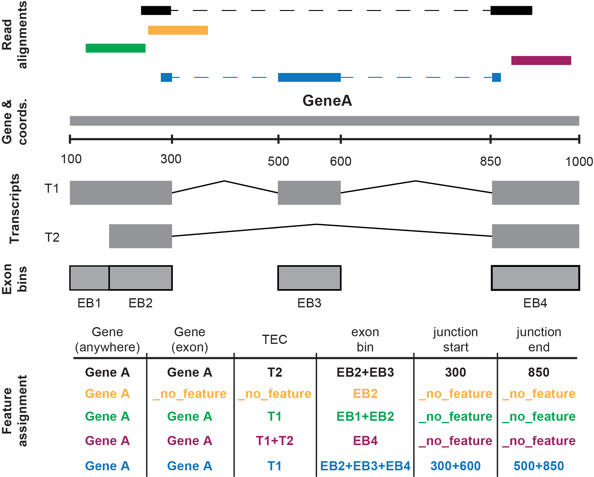

## Feature assignment

As documented elsewhere on this website, the real novelty of fastq2EZbakR is the broad array of genomic features to which reads can be assigned. The exhaustive list is:

1. Genes (anywhere)
1. Genes (exons only)
1. Exonic bins (as in DEXSeq)
1. Transcript equivalence classes (e.g., set of transcript isoforms with which a read is fully compatible)
1. Exon-exon junctions (from STAR `jI`/`jM` tags or spliced CIGAR `N` coordinates)
1. 3'-ends (introduced in version 0.8.0; only compatible with 3'-end sequencing data, like what you get from the popular Quant-seq SLAM-seq kit).
1. Exon-exon junctions (generalized but experimental; use with caution for now. More details below)
1. Exon-intron junctions (experimental; use with caution for now. More details below)

What follows is details regarding the nuance of each of these strategies, and suggestions as to how to most effectively use them:

### Summary

1. Genes (anywhere) uses featureCounts to assign reads to anywhere in a gene. The defaults in the provided config.yaml will assign reads that partially overlap with a single annotated gene. Thus, even if a read partially overlaps with an unannotated region, it will be assigned to the gene with which it overlaps. This can be changed by adding `--nonOverlap` to the `fc_genes_extra` parameter in the config.yaml file. See note in Genes (exon only) section about how soft-clipping can complicate the use of this parameter. 
1. Genes (exons only) uses featureCounts and its `--nonOverlap` parameter (documentation [here](https://subread.sourceforge.net/SubreadUsersGuide.pdf)) to find reads that only overlap exonic regions of a gene. This has a minor limitation discussed [here](https://support.bioconductor.org/p/9157388/#9158726) that soft-clipped bases are counted as "non-overlapping". Thus, you will either have to use a sufficiently lenient `--nonOverlap` parameter to avoid not assigning soft-clipped reads, or alter alignment parameters to avoid soft-clipping (e.g., in STAR this means setting `--alignEndsType EndToEnd`).
1. Transcript equivalence class assignment (`tec`) assigns each read or read pair to the set of annotated isoforms with which it is both strand- and splice-compatible. In `tec_mode: "auto"` (the default), STAR FASTQ runs parse the strand-filtered RSEM/STAR transcriptome BAM, while HISAT-3N, HISAT2, and external BAM runs (or `tec_mode: "genome"`) assign reads directly against the annotation GTF from the genome BAM (allowing up to `tec_end_overhang` bp overhang at transcript 5'/3' ends while requiring exact internal splice matches).
1. Exonic bins assignment uses a standalone Python flattener (`flatten_annotation.py`) to build DEXSeq-style disjoint exonic bins (handling opposite-strand overlapping genes cleanly and disambiguating multi-locus duplicate `gene_id`s as `<gene>_loc1`, `<gene>_loc2`, ...) and assigns reads with featureCounts. Because it will assign reads to exonic bins even if part of the read overlaps intronic regions, it is best paired with either Genes (exons only) or Transcript equivalence class assignment so pre-mRNA reads can be filtered out as necessary.
1. There are two exon-exon junction assignment strategies, one under the name `junctions` in the config.yaml file, and the other under the name `eej`. `junctions` uses STAR's `jI` and `jM` tags when present and otherwise extracts exact spliced intron coordinates from CIGAR `N` operations, making it compatible with STAR, HISAT-3N, HISAT2, and external BAM files. `eej` is a less accurate, experimental option using featureCounts and a synthetic junction GTF.
1. The exon-intron junction assignment strategy, like `eej`, is stil experimental. Both `eej` and `eij` involve creating a custom annotation with new junction features within a small window around each junction. featureCounts only assesses read nucleotide overlap with a given feature though, so you can run into instances where a read doesn't actually overlap with the junction, it just overlaps with a small portion of the junction window defined in the custom annotation. The accuracy of assignments by these two strategies can be bolstered by combining them with transcript equivalence class assignment (to filter out purely exonic reads that are misassigned to an exon-intron junction) and the always present sj column of the final cB, which tracks whether or not a gap existed in the reads alignment (e.g., orthogonal evidence for any exon-exon junction assignments).
1. Several of the assignment strategies can see a read assigned to multiple features (e.g., a read overlapping multiple distinct exonic bins). In these cases, the relevant entry in the cB table will look like "featureID1+featureID2+...+featureIDN", where "featureIDi" is the name of the ith feature of the relevant type that the read was assigned to. Reads not assigned to any feature are given a string of "__no_feature". For both of the gene-level assignments, reads overlapping with multiple genes will be flagged as "__no_feature", which is featureCount's default behavior for multi-assigning reads.

### 3'-end assignment

In version 0.8.0, I introduced a new feature assignment strategy: assignment to 3'-ends. There are two ways to run this strategy: 1) using annotated 3'-ends (`call_threeputrs: False`) or 2) building a 3'-end annotation de novo from your data (`call_threeputrs: True`).

In either case, reads are aligned as usual and then assigned to 3'-ends using featureCounts, using only the 3'-most nucleotide for determining which 3'-end the read is assigned to. If using strategy 1), any explicit `"3UTR"` features in your GTF are reused (with missing `utr_id`s filled in automatically); if your GTF does not include `"3UTR"` features, fastq2EZbakR automatically derives an augmented annotation from each transcript's terminal exon.

If using strategy 2), then:

1. The relevant ends of reads are clustered to identify 3'-end pileups representing possible bona fide 3'-ends (for the standard Quant-seq FWD library typically paired with SLAM-seq, this means using the 3'-most nucleotide in each read)
1. These putative 3'-ends are then filtered. The following criteria are applied:
    - If `only_annotated_threeputrs` is `True`, then only those called 3'-ends that overlap with annotated last exons will be kept.
    - If `only_annotated_threeputrs` is `False`, then putative 3'-ends that don't overlap annotated last exons will only be kept if they are not close to a long polyA stretech ("long" defined as whatever you set `false_polyA_len` to). This is to filter out mispriming events that don't represent actual priming to polyA tails
    - If `require_CPA_site` is `True`, then in addition to the polyA filter, 3'-ends not overlapping annotated last exons will also need to be near a CPA consensus sequence (`AAUAAA` or `AUUAAA`).
1. Several coverage-based cutoffs are also applied to filter out low coverage 3'-ends:
    - In each sample, a given 3'-end (a single nucleotide) needs `coverage_cutoff` reads to be considered a real 3'-end that goes into 3'-end clustering.
    - Across all samples, there needs to be a total of `cluster_coverage` reads whose 3-most end overlap the cluster (default is 20 x # of samples).
    - `cluster_fxn` of reads across all samples that map to a given gene need to come from a given 3'-end for it to be included. For example, if `cluster_fxn` is 0.1, then at least 10% of reads that map to a given gene need to come from a given 3'-end for that 3'-end to make it to the final annotation.
1. An annotation of called 3-ends is generated and used for read assignment. 3'-ends are named "\<gene_id\>_#", where "#" is a number between 1 and the number of 3'-ends called that overlap a given gene.

I developed this strategy for a couple reasons:

1. Most people doing SLAM-seq combine it with 3'-end sequencing due to the popularity of the relevant Quant-seq kit. Thus, this assignment strategy allows users of this and similar kits to get the most out of their data.
1. The unique, powerful use case of NR-seq data is in probing RNA turnover regulation, and the sequence of a trancsript's 3'-UTR is a major determinant of its stability.

### Figures to help

Below are two figures that schematize the non-experimental feature assignment strategies in fastq2EZbakR. 

Figure 1: Each of the established assignment strategies (except 3'-end assignment, which is described more above).

Figure 2: Example assignment of a set of reads to all established assignment strategies. Notes: 1) coords. is short for "genomic coordinates"; 2) dotted line in read alignment section denotes gaps in alignment (in this case, all instances represent splice junction mapping reads).

